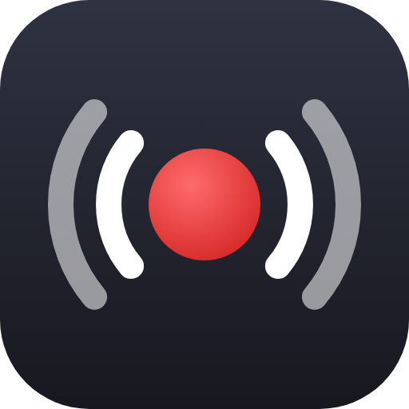
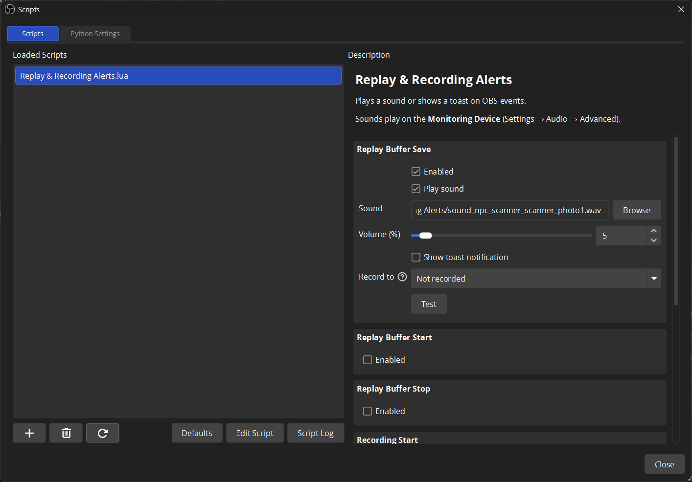

# Replay & Recording Alerts

An [OBS Studio](https://obsproject.com/) Lua script that plays a sound, shows a toast notification, or both, when you save a replay or when recording, streaming, the replay buffer or screenshots start, stop or save.

- Each event has its own sound, volume and toast.
- Sounds play on OBS's **Monitoring Device** and stay out of recordings, unless Desktop Audio captures that device too (see below).
- Supports WAV, MP3, OGG, FLAC, M4A and Opus.

## Installation

1. Download the zip from the [latest release](../../releases/latest) and extract it. Keep the `.lua` and `.wav` files in the same folder.
2. In OBS, open **Tools → Scripts**, click **+** and pick `Replay & Recording Alerts.lua`.
3. Enable the events you want, set them up as desired and press **Test**.

## Keeping sounds out of recordings

Desktop Audio records everything on its device. If your Monitoring Device is the same device, the sounds get recorded too.

### Options to fix this
- Pick another device in **Settings → Audio → Advanced → Monitoring Device** (for example, speakers while Desktop Audio captures headphones). Keep in mind that from that point on, the alert sound will play through that device instead of your main one.
- Alternatively, switch from Desktop Audio to an **Application Audio Capture** source. This lets you capture main audio directly without altering your Monitoring Device setup.

## Notes

- **Windows:** toasts come from *OBS Studio*, or from *Windows PowerShell* for a portable OBS.
- **macOS:** toasts come from *Script Editor*. Allow its notifications in System Settings → Notifications.
- **Linux:** toasts require the `notify-send` program (`libnotify-bin` package on Ubuntu / Debian / Mint or `libnotify` on Arch / Fedora / RHEL / CentOS).

## Reporting problems

Before opening an [issue](../../issues), reproduce the problem and attach your OBS log (**Help → Log Files → Upload Current Log File**). The script logs each event and any errors there.

## Credits

- Based on the [*Beep on replay buffer save*](https://gist.github.com/snakecase/e816384a071cec31efbb4b9e429c108d) script.
- The default sound is the City Scanner camera shutter from *Half-Life 2* (© Valve Corporation).

## License

The script is dedicated to the public domain under [CC0 1.0](LICENSE). The default sound belongs to Valve and is not covered.
